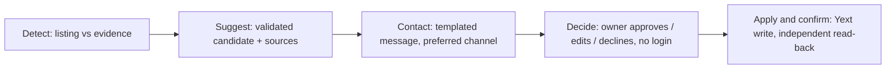

# Connect Suggests — Nordic opening-hours suggestions

Built by **OldJeans** for the **Since AI 2026 × Fonecta** challenge.

**All data is synthetic. No real businesses, customers or Fonecta data.**

Wrong holiday hours turn an online search into a closed door, and they quietly cost
visibility: a listing with missing or outdated hours can drop out of "open now"
searches exactly when holiday demand peaks. Connect Suggests is a reference product
that detects likely wrong hours for Nordic businesses, proposes a correction backed
by evidence, asks the owner to decide without any login, and — only on an explicit
decision — writes the approved hours through the Yext API and reads them back to
confirm. Correct listings stay quiet; uncertainty and genuine conflicts are handled
differently.



## Run it

Verified on **Python 3.10 in Ubuntu/WSL**. The runtime lock uses
`fcntl`, so **native Windows Python is not supported** — use WSL there. macOS has not
been verified. The basic mock
demo needs **no API keys and no Node.js**.

```sh
git clone https://github.com/OldJeans-sinceAI/Oldjeans-Repo.git
cd Oldjeans-Repo
python3 -m venv .venv
.venv/bin/python -m pip install -r requirements.txt
.venv/bin/python run_demo.py --mode mock --port 8000 --mock-port 8787
```

Use `run_demo.py` (it starts the site plus an isolated local Yext mock); do not start
the server with `python -m app.server`. Open **http://localhost:8000** on the machine
running the app and stop with Ctrl+C. The demo clock is frozen at **6 Nov 2026** and
the storylines target **24 Dec 2026** (Christmas Eve). The app binds to loopback only,
so over SSH forward port 8000 to your own machine first. Optional settings can be
copied from `.env.example` to `.env`; the supplied dataset stays unchanged and working
state is written under the ignored `runtime/` directory. Proposals, decisions, and
contact preferences belong to that application state: no custom Yext Knowledge Graph
fields or new publishers are added.

**Optional Gemini (owner-reply interpretation).** Set `GEMINI_API_KEY` privately in
`.env` and keep `GEMINI_ENABLED=true`; the key stays server-side and is never sent to
the browser. The tested default model is `gemini-3.5-flash-lite`. Without a key the
demo still runs — buttons, yes/no and exact intervals use local rules, and complex
free text asks for exact hours instead of pretending a model was called.

**Optional real Yext sandbox (`--with-sandbox`).** Writing to the team's real Yext
workspace is opt-in and requires mock mode plus configured credentials
(`YEXT_API_KEY`, `YEXT_ENTITY_ID`). It adds a `/sandbox/` workspace that targets a
single shared entity and still requires explicit owner approval before any write. The
bundled reset baseline is verified only for that one entity's `hours`; it is not a
general production reset. Never commit keys.

With those credentials configured, run:

```sh
.venv/bin/python run_demo.py --mode mock --with-sandbox
```

## Build status (scope of this document)

This README describes what runs from the current `main` branch: the guided five-step
demo, the WhatsApp-style owner chat, and the full operator workspace (`web/app.js`,
`web/demo.js`, `web/whatsapp.js`). Additional channel mock-ups (email and SMS
reply-only layouts) and revised journey navigation are tested locally but **not yet
merged to `main`**; treat them as in progress. Earlier local runs recorded 95 product
and 23 browser checks against the local tree. Separately, on **8 Nov 2026**, a fresh
checkout of `main` at `a1c50b6` passed **95 product tests** and **14 browser journey
checks**, including the 3,032-entity scan, approve/edit/decline, independent mock
read-back, concurrent-change rejection, and the no-Gemini fallback. These checks used
an isolated mock; they did not send real messages or repeat the live sandbox write.
The subsequent `main` refactor at `95d1eff` also passed all **7 HTTP contract tests**.

## The five steps

1. **Detect** — scan the fleet and compare each listing with dated evidence; classify
   SUGGEST / NO_ACTION / FLAG. No messages or decisions are created here.
2. **Suggest** — select and validate a candidate from ordered evidence, explain the
   sources, and choose whether to propose, flag for staff, or stay silent.
3. **Contact** — build an English message for the owner's preferred channel,
   respecting opt-outs, pauses, and contact cadence. Delivery is always **simulated**.
4. **Decide** — the owner approves, edits, or declines from a capability link, **no
   account creation**. Edited hours and free-text replies are previewed and require
   explicit confirmation before anything is written.
5. **Apply & confirm** — only the approved date/scope is merged into the existing
   hours, then independently read back. Success, pending, failure, and rejection stay
   distinct; publisher timings are estimates, not proof of live publication.

For a walkthrough, open **Guided demo**, select **2026-12-24**, and click
**Scan all 3032 businesses → Review a suggestion → Prepare the owner message**.
Open the owner view, approve/edit/decline, then return to the guide to inspect the
result. A scan checks the entire directory; each owner decides only their own proposal.
The **Workspace**, **Inbox**, and **Staff review** tabs expose the underlying work.

**Where AI is used.** Detect, Suggest, and Contact are deterministic evidence rules and
templates. A generative model (Gemini, when configured) is used only to interpret a
*complex* natural-language owner reply; exact replies and buttons use a local parser.
The product does **not** claim an AI that invents every schedule or message. Confirmed
owner outcomes are recorded and reused as evidence — this is **history reuse, not model
training**; no trained ranker ships in this branch.

## Data sources that mattered most

| Signal | How we used it | Production counterpart |
|---|---|---|
| Owner holiday-hours history (`holiday_hours_history.jsonl`) | Primary evidence: the owner's own confirmed exceptions for the same holiday seed a proposed time | Connect audit log |
| Calendar of special days (`calendar_special_days.csv`, FI/SE/NO) | Identify which dates need a decision (holidays, eves, observances) | Public-holiday APIs and municipality calendars |
| Shopping-centre schedules + peer benchmarks (`entities.json`, `peer_benchmarks.csv`) | Corroborate proposals where the business has demonstrated centre alignment or sufficient supporting evidence; nearby businesses alone do not determine hours | Centre operators' schedules and anonymised Connect history |
| Publisher suggestions + reviews (`publisher_suggestions.json`, `reviews.json`) | Signals that a listing may be wrong; combined evidence can trigger staff review, never an unapproved write | Yext Publisher Suggestions / Reviews |
| Daily analytics (`analytics_daily.parquet`) | Help prioritise business impact; the evaluator reports at-risk search views protected | Yext Analytics Reports |

## Customer with no history

For **2026-12-24**, a **new customer with no exception history and no previous decisions** —
`FI-D0017` Kahvila Kipinä — does not receive guessed hours. The system returns
an internal NO_ACTION/defer and generates **no customer message**, recording "not
enough evidence to propose exact hours; recheck when relevant owner evidence arrives."
Related cases: `FI-D0011` (possible permanent closure) is **flagged** for staff rather than
suggested, and `FI-D0013` (already-correct hours) is left **retained** in silence.

## Final customer messages (as text)

All delivery is simulated. **English is the demo's supported language** for both UI
and outbound messages. The exact contact-preview text for synthetic business
`FI-D0001` (Kahvila Aurora) is:

```text
Hi Kahvila Aurora!

2026-12-24 (Christmas Eve)
Currently shown: 07:30-18:00.
Your confirmed hours for this holiday in a previous season support these times.
We propose: 07:30-13:00.

Approve / Edit / No thanks
```

The owner view includes this uncertainty statement:

> This evidence does not confirm your final plan for this date. You decide.

Follow-ups are displayed in the owner view; no external follow-up message is sent:

- **Approve:** "Hours saved and checked." followed by "We read the hours back after
  saving to verify the change." This is shown only after the read-back matches.
- **Edit:** enter `07:30-15:00`, preview, and confirm separately. The outcome displays
  the edited date and hours, then the same saved-and-checked confirmation. Without a
  model, exact hours or the manual editor still work.
- **Decline:** "Current hours kept." followed by "No update was requested."

For a successful save, the publisher section says: "These are typical timings from
the mock dataset, not confirmation of live publication."

## Real Yext apply and reset proof

On 7 Nov 2026 an end-to-end live write was verified against a single shared sandbox
entity (`SinceAI18`): owner approval → app decisions API → Yext PUT of one date
(`2026-12-24` → 07:30–13:00) → independent GET read-back, with unrelated hours
preserved. This proves the write path on **one** entity; bulk detection stays on the
**3,032-entity** mock directory (businesses and shopping centres). Reset restores only that entity's `hours` to its verified
pre-change state and stops with a conflict rather than overwriting unexpected external
changes. Publisher timings come from the supplied `listings.json` as **estimates** —
not observation of live propagation at Google or any publisher.

## Scoring and evaluation

```sh
.venv/bin/python -m unittest discover -s tests/product -p 'test_*.py'
.venv/bin/python examples/baseline.py
.venv/bin/python evaluation/evaluate.py --predictions outputs/baseline_predictions_2026.csv
```

An existing saved predictions file (41,755 rows) rescored on the labelled **developer
split** (11,100 rows):

| Set | Score /100 | Exact precision | Recall | Harmful |
|---|---|---|---|---|
| Saved dev predictions | 55.11 | 82.2% | 64% | 382 |
| Supplied baseline (dev) | 54.49 | 90.1% | 59% | 224 |

It protected an estimated **62.7%** of at-risk search views. These are **historical
developer-split** figures — not the organisers' hidden **test** split and not a
re-measurement of the current refactored `main`. Higher recall came with more harmful
suggestions; calibration remains unfinished. Placing `predictions_2026.csv` at the
repository root is optional for the organisers' score (not included here); verify any
file with the official evaluator. To generate this product's optional submission CSV:

```sh
.venv/bin/python -m app.evaluate --output predictions_2026.csv
.venv/bin/python evaluation/evaluate.py --predictions predictions_2026.csv
```

Inference uses the frozen evidence cutoff and does not read the answer labels or
runtime owner decisions. The evaluator reads the labelled dev split separately.

## What we tried that didn't work

- **Slow or failed Gemini replies, including explicit `thinkingLevel` probes.** We
  bound the interpreter to an 8-second budget, use the model default, and
  treat any timeout as "pending" — never as consent or refusal.
- **Auto-resolving ambiguous replies** ("Maybe at five"). These must stay uncommitted
  and ask for exact hours; silence or vagueness is not consent.
- **Treating last season's hours as current fact.** Historical hours are evidence for a
  proposal the owner must confirm, not proof of this year's operation.

## Third-party code, data and licences

Verified versions in the Python 3.10 environment:

| Component | Version | Licence |
|---|---|---|
| python-dotenv | 1.2.1 | BSD-3-Clause |
| jsonschema | 4.25.1 | MIT |
| pandas | 2.3.3 | BSD-3-Clause |
| pyarrow | 22.0.0 | Apache-2.0 |
| numpy | 2.2.6 | BSD-3-Clause |
| playwright | 1.58.0 | Apache-2.0 |

The supplied simulator code is **MIT** and the synthetic data is **CC BY 4.0**
(© 2026 Since AI ry). The reply interpreter and WhatsApp layout incorporate teammate
contributions that carry **no separate licence file** (per `NOTICE`); their source
attribution is preserved and no additional licence or blanket relicensing is asserted.
The listed product dependencies use permissive licences. See [LICENSE.md](LICENSE.md)
and [NOTICE](NOTICE) for the supplied materials and source attribution; these do not
grant a blanket licence to all team additions. The optional Node connection test uses
Axios (MIT), dotenv (BSD-2-Clause), and nodemon (MIT, development tool).

## Optional: Node Yext connection test

Separate from the Python demo (which needs no Node), the repository keeps a teammate
Node.js connection test against a real Yext account. `.nvmrc` selects Node **v20.11.0**.
Configure `YEXT_API_KEY` and `YEXT_ENTITY_ID` privately in `.env`. This older test
expects `YEXT_BASE_URL=https://sbx-api.yextapis.com/` **with the trailing slash**:

```sh
nvm install
nvm use
npm ci
npm run test:yext
```

On success it prints the connected business name. Keys stay out of the repository.

## Roadmap and limitations

- Only opening hours are modelled; the owner simulator is a statistical stand-in, not
  real behaviour, and message delivery is simulated.
- Next: production contact adapters with real operator authentication, live-source
  freshness, and calibrated ranking learned from explicit owner outcomes.
- The bonus "replace a dataset file with a live source" is **not** implemented in this
  branch.
